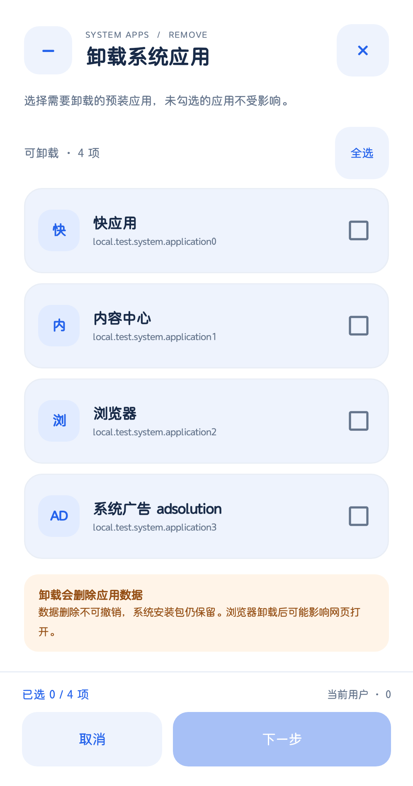
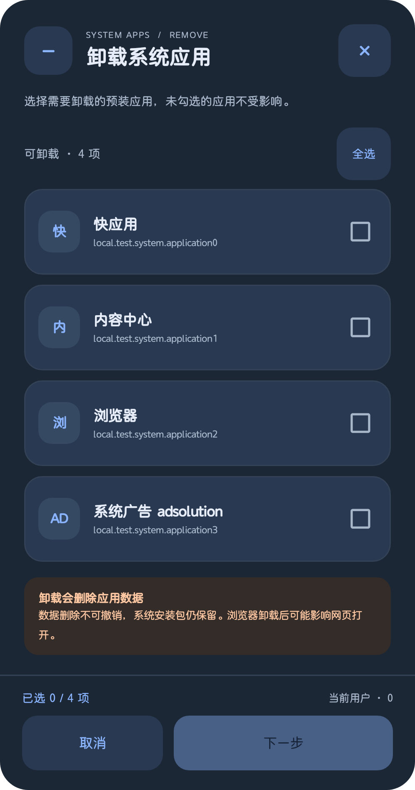

# 轻控 1.0.8：系统应用勾选弹窗美化

## 本次变化

- 卸载与恢复使用 `SystemAppsDialog`，复用主页的圆角卡片、蓝色强调色和浅/暗主题。
- 应用分类标记、名称、包名分层展示，支持整行勾选和可访问的选中状态。
- 增加全选/取消全选、已选数量、当前用户提示；默认不勾选，空选择时禁用下一步。
- 选择与最终确认在同一弹窗内切换，返回保留选择；取消、关闭及返回选择不提交操作，最终确认只提交一次。
- 每次切换页面使用独立的交互代次，旧页面排队点击不会越过确认，也不会改变确认页展示的勾选；关闭后的旧控件同样失效。
- 保留数据删除风险及恢复不找回数据的提示。底部操作固定，主体内容可滚动，大字体下不挤掉底部按钮。
- 保留原来的卸载/恢复后端：白名单、用户范围、无 `-k` 卸载、恢复命令、执行前重查与执行后读回均不变。

## 交付与回滚

- APK：`../../releases/usb-control-v1.0.8.apk`，同目录有 `.sha256`。
- 源码补丁：`changes.patch`。
- 验证记录：`verification.json`；原有回归命令、输出及退出状态见 `regression/verification.json`。
- 回滚脚本：`../../scripts/rollback-usb-control-dialog.py`，默认恢复本工作区的源文件与 1.0.7 发布包；运行前检查原件和当前文件哈希。
- 回滚原件：`rollback-originals.zip`。脚本已在独立副本执行并核对原始字节，不会在验证时改回当前工作区。
- 手机降级是独立动作，本次没有降级手机；如需降级，可在恢复旧发布包后另行执行 `adb install -r -d releases/usb-control-v1.0.7.apk`。

## 验证范围

主机上复验已有 model、USB 适配与系统应用测试，以及 APK 签名、对齐、校验值、版本和 ZIP 完整性。

真机 instrumentation 使用虚拟应用条目和计数回调，直接测试生产弹窗，不调用实际卸载/恢复后端。覆盖浅/暗色与两种操作的布局、默认未选、整行点选、全选、清空、返回保留勾选、最终确认一次性提交、取消和无障碍选中状态；另检查 1.6 倍字体下底部按钮可见。

横屏仅在设备实际应用横屏配置时计入覆盖；锁屏等条件导致请求未应用时明确记为跳过。最终通过数量与跳过项以 `verification.json` 为准。组件预览由应用自身弹窗视图绘制，不采集锁屏或其他应用内容；本次不为测试解除设备锁屏。

手机测试期间没有实际卸载或恢复系统应用，包列表在测试前后核对不变。测试辅助 APK 单独安装、测试结束后移除，不作为发布包的一部分。

早期 instrumentation 遇到设备后台启动拦截及锁屏下延迟布局，测试工具改为有时限的前台启动，并在需要时对应用自身组件按视口显式测量；没有修改系统后台策略或解除锁屏。原测试使用逐次等待主线程完全空闲，在设备现有界面事件下出现超时，改为等待具体 UI 操作完成后，最终两轮各 68 项均通过，横屏也在真机完成且无跳过。

尝试启动的只读测试模拟器未正常就绪，已经停止，仅以最终真机结果作为通过证据。除界面组件外，不声称本轮重新验证了所有 ROM 的实际卸载行为。

Windows 下补丁验证固定使用 `git -c core.autocrlf=false -c core.eol=lf apply`，避免 Git 配置造成属性文件换行变化；完整源码/发布文件回滚则从原件 ZIP 按字节恢复，不依赖 Git 的换行转换。

## 组件预览

以下为生产弹窗配合虚拟条目的组件绘制，包名不是手机实际安装列表。

